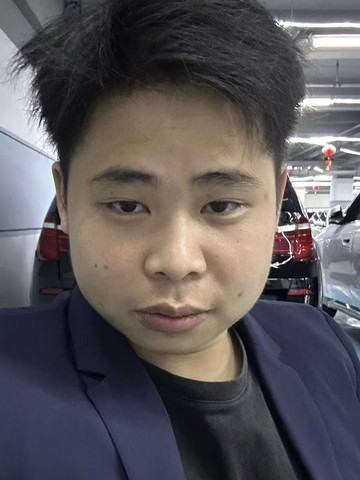

# 岑荣马（Matcen）自我介绍

## 一句话版（加好友、名片、群里自我介绍）

> 我是岑荣马，做外贸 AI 运营的。用 ChatGPT 和 Claude 帮工厂做独立站、谷歌 SEO、Facebook 投流和客户开发，公司网站上了 AI 以后自然询盘 150 多个。只要是 AI 能解决的问题，都可以找我聊。

## 30 秒版（见面、电话、语音）

大家好，我叫岑荣马，英文名 Matcen，2003 年出生，广西河池南丹人，现在在深圳，2023 年开始做外贸。

我做外贸 AI 运营，每天用 ChatGPT（Codex）和 Claude 两个大模型干活：搭建外贸独立站、做谷歌 SEO 和 AI 搜索优化、Facebook 投流、海外社媒视频、主动开发客户。AI 帮我完成大约 80% 的执行，我负责诊断、核对和把关。

今年 7 月底在公司网站部署 AI，到现在自然流量询盘已经 150 多个。海外账号注册、跨境办公网络、AI 工具部署和调教，我也能一站式帮团队搞定。

## 详细版（微信长文、朋友圈、面试开场、给老板的介绍）

### 我是谁

我叫岑荣马，英文名 Matcen，2003 年 12 月出生，广西河池南丹人，毕业于广西建设职业技术学院，现在在深圳做外贸 AI 运营。

我 2023 年开始接触外贸，从跟单做到运营。2026 年 AI Agent 出来后，我 3 月开始用，4 月底已经能熟练用它干活，4 个月就跑出了 150+ 自然询盘。

我的优势是学得快、落地快：新工具一周上手，现在在学 Python、API 对接和 Dify / Coze 智能体编排，目标是帮外贸团队搭 CRM 和自动化获客系统。

### 我能帮你做什么

**1. 外贸独立站 + 谷歌 SEO + AI 搜索优化（GEO）**
- 从关键词研究、网站架构、页面文案、产品体系到技术检查，一个人带着 AI 做完。
- 真实结果：公司网站 7 月底上 AI，到现在自然询盘 **150+**，第三方 SEO 审核 **90 分**。
- 我能 30 分钟看出一个网站的致命问题：为什么没流量、为什么不收录、为什么有流量没询盘。

**2. Facebook 投流与数据自动分析**
- 表单投流、互动投流，AI 自动拉数据、算有效线索成本、给出下一步测试建议。
- 8 月底开投，总消耗约 2500 元：表单 15 个线索，互动 40 多个。

**3. 海外社媒内容与视频**
- Facebook、YouTube、TikTok 的选题、脚本、剪辑，AI 做 80%，我审核 20%。

**4. AI 主动开发客户**
- 用 AI 在 Google 地图和社媒上找真实买家、核实、去重、评分、写开发信。
- 已拿到 28 个询盘，12 个在跟进。

**5. 海外账号、跨境办公网络、AI 工具部署**
- Google、Meta、TikTok、YouTube、LinkedIn、ChatGPT、Claude 等海外账号的注册、认证、维护，懂各平台风控。
- 帮团队配置独享线路的跨境办公网络，环境干净稳定，账号不容易出问题。
- 把 ChatGPT、Claude 部署到公司，按岗位写好提示词和流程，教会业务员用。

**6. AI 日常办公和业务系统**
- 文档、表格、报告、数据分析都交给 AI 处理。
- 正在研究用 AI 搭 CRM 客户管理、报价系统这类外贸业务系统。

**7. 其他领域**
- 电气工程：把资料喂给 AI，做 CAD 图纸策划，出图能接近业主要求的 95% 左右。
- 只要 AI 能布局、能解决问题的事，我都可以去做；新领域需要一点学习时间，但我学得快。

### 我的做事方式

- **先诊断，再动手**：先找出问题在哪，只修最关键的地方，改完用数据验证。
- **AI 做 80%，我把关 20%**：AI 负责执行，我负责判断、核实和拍板，不让 AI 乱编数据。
- **结果说话**：看询盘、看线索、看成交，不看做了多少动作。

### 适合找我的人

- 外贸工厂老板：网站没询盘、投流没效果、业务员不会用 AI
- 外贸团队：需要海外账号、跨境办公环境、AI 工具一站式落地
- 想用 AI 提效的公司：日常办公、内容生产、客户开发、内部系统

### 联系我

- 电话 / 微信：+86 136 1031 4007
- 邮箱：romancenanyi@gmail.com
- GitHub：github.com/romancenanyi-png（简历公开；知识库需要密码，可以找我要）

---

## English version (short)

Hi, I'm **Matcen (Rongma Cen)**, born in 2003, based in Shenzhen, China.

I'm an AI automation and digital growth specialist for B2B export businesses. I work every day with ChatGPT (Codex) and Claude to build B2B websites, run SEO and AI-search (GEO) content, Facebook ad funnels, social video, and buyer prospecting. AI handles about 80% of the execution; I do the diagnosis, fact-checking and approval.

Since we deployed AI on our company website at the end of July 2026, it has brought in **150+ organic inquiries**. In foreign trade since 2023, I learn fast and ship fast. If a problem can be solved with AI, I can take it on.

📫 romancenanyi@gmail.com · github.com/romancenanyi-png
